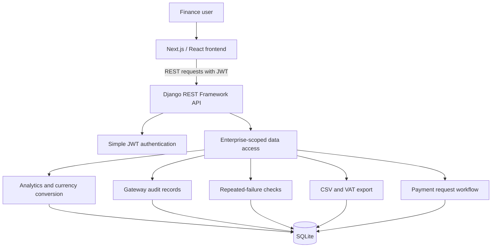
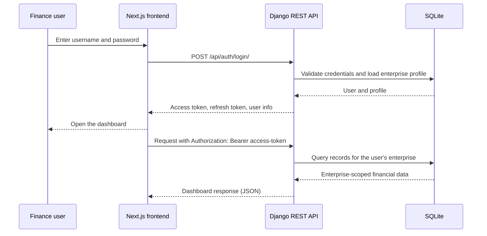
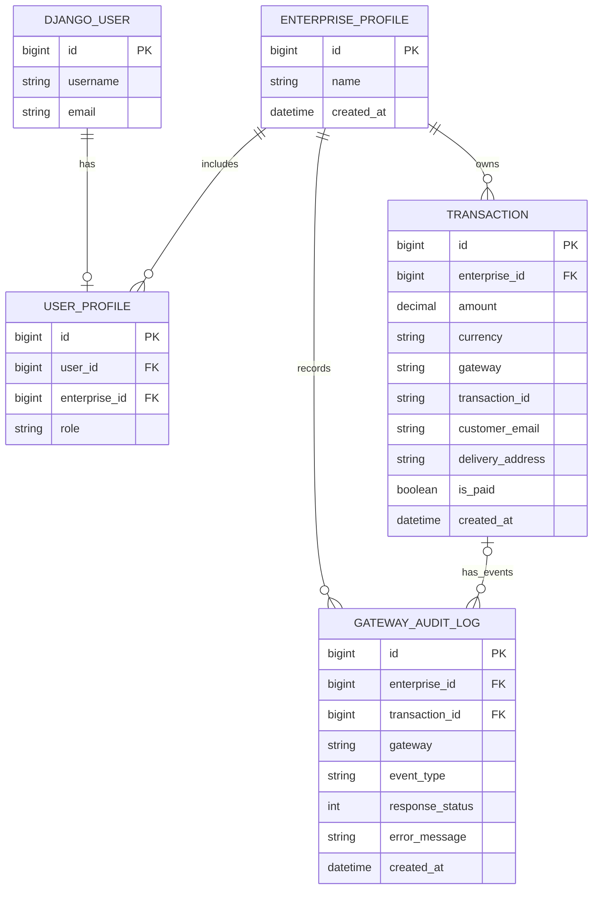

db.sqlite3              Local development database
# 🌐 Nexus Global ERP — Multi-Tenant FinTech & Transaction Analytics

Nexus Global ERP is a FinTech transaction operations application for finance teams managing payments across multiple gateways and currencies. It combines an authenticated Next.js dashboard with a Django REST API, enterprise-scoped transaction data, gateway audit records, repeated-failure alerts, and accounting exports. XAF is supported as a reporting currency for businesses operating in the CEMAC region.

## 🎯 Business Problems Solved

- **Fragmented payment records:** Bring transactions from card, bank transfer, Stripe, PayPal, Payoneer, Mobile Money, other methods, and crypto into one enterprise-scoped ledger.
- **Unclear payment failures:** Record gateway event details, response status, response payload, and error message so finance teams can investigate a failed payment with its recorded context.
- **Hard-to-compare international balances:** Convert transaction values into a selected reporting currency, including XAF, EUR, USD, BTC, and ETH.
- **Repeated failed payments that go unnoticed:** Flag repeated failures associated with the same customer email or delivery address for review.
- **Time-consuming month-end preparation:** Export filtered transactions to a structured CSV with VAT and total calculations.
- **Limited customer payment choice:** Create a tracked payment request using a method familiar to the customer and market.

## 📸 Application Preview

The application includes a login screen, an analytics dashboard, and a payment-request screen. Start the frontend and backend using the instructions below to view them locally at `/login`, `/dashboard`, and `/invoice`.

## 🏗️ Architecture & Data Flow

The current development architecture uses a Next.js frontend, a JWT-authenticated Django REST API, and SQLite for persistence.



### 🔐 JWT Authentication Flow



### 🧩 Core Data Model



## 🛠️ Product Modules

### 1. FinMatrix — Multi-Gateway Transaction Analytics

- View transaction counts and paid revenue totals by payment method.
- Filter the transaction ledger by gateway and payment status.
- Compare transaction amounts in the selected dashboard currency.

### 2. Enterprise Data Isolation

- Associate each user profile with an enterprise and a role (`MANAGER` or `ACCOUNTANT`).
- Scope dashboard, audit, export, and payment API operations to the authenticated user's enterprise.

### 3. Gateway Audit Trail

- Store gateway, event type, request and response payloads, response status, and error details.
- Link an audit event to a transaction when its transaction ID is provided.
- Review recent audit events directly from the dashboard.

### 4. Multi-Currency Reporting

- Display and aggregate transactions in XAF, EUR, USD, BTC, or ETH.
- Keep the original transaction amount and currency in the ledger.
- Use XAF as the base for the rates configured by the application.

### 5. Repeated-Failure Alerts

- Detect three or more unpaid transactions sharing a customer email or delivery address within the last 24 hours.
- Present these signals as review alerts on the dashboard.

### 6. Accounting Export

- Download transactions as CSV, with optional gateway and payment-status filters.
- Include original amount, currency, VAT rate, VAT amount, and total with VAT.
- Use a configurable VAT rate; the export defaults to 19.25%.

### 7. Payment Requests

- Create requests for bank cards, bank transfers, Stripe, PayPal, Payoneer, Mobile Money, other methods, Bitcoin, or Ethereum.
- Record each request and its confirmation event in the transaction and audit ledgers.

## 💻 Technology Stack

- **Frontend:** `Next.js 16` | `React 19` | `TypeScript` | `Tailwind CSS` | `Chart.js`
- **Backend / API:** `Python` | `Django 6` | `Django REST Framework` | `Simple JWT`
- **Database:** `SQLite`
- **Authentication:** JWT access and refresh tokens

## 🚀 Local Development Setup

### Prerequisites

- Python and Node.js with npm
- PowerShell for the commands below (adapt the virtual-environment activation command for other shells)

### 1. Install backend dependencies

From the project root:

```powershell
python -m venv venv
.\venv\Scripts\Activate.ps1
python -m pip install Django djangorestframework djangorestframework-simplejwt django-cors-headers
```

### 2. Apply migrations and prepare demo data

```powershell
python manage.py migrate
python manage.py shell -c "from finance.management_script import generate_mock_data; generate_mock_data()"
```

The data script creates a sample enterprise, manager and accountant accounts, and sample transactions.

Demo manager credentials:

- Username: `manager_demo`
- Password: `PasswordDemo2026`

### 3. Start the backend

In a terminal at the project root:

```powershell
python manage.py runserver 8000
```

The API base URL is `http://localhost:8000/api/`.

### 4. Install and start the frontend

In a second terminal:

```powershell
cd frontend
npm ci
npm run dev
```

Open `http://localhost:3000/login` and sign in with the demo manager account.

## 🔌 API Reference

All endpoints except login and token refresh require a JWT access token in the `Authorization: Bearer <token>` header.

| Method | Endpoint | Purpose |
| --- | --- | --- |
| `POST` | `/api/auth/login/` | Obtain JWT tokens and user/enterprise details. |
| `POST` | `/api/auth/refresh/` | Refresh an access token. |
| `GET` | `/api/dashboard/metrics/?currency=XAF` | Return enterprise metrics, converted transactions, recent audit entries, and repeated-failure alerts. Supports `gateway` and `is_paid` filters. |
| `GET` | `/api/exchange-rates/` | Return the configured currency rates with XAF as the base. |
| `GET`, `POST` | `/api/audit-logs/` | List audit events or record an event with gateway response and error details. |
| `GET` | `/api/transactions/export/?tax_rate=19.25` | Download a CSV export; supports `gateway`, `is_paid`, and `tax_rate` query parameters. |
| `POST` | `/api/payments/invoice/` | Create a tracked payment request. |
| `POST` | `/api/payments/confirm/` | Confirm a payment request in the demo workflow. |
| `POST` | `/api/crypto/invoice/` | Generate a standalone crypto invoice. |

## ✅ Tests & Quality Checks

Run backend tests and Django checks from the project root:

```powershell
python manage.py test finance
python manage.py check
python manage.py makemigrations --check --dry-run
```

Run frontend checks from the `frontend` directory:

```powershell
npm run lint
npm run build
```

## 📁 Project Structure

```text
config/                 Django project settings and root URL configuration
finance/                Enterprise, transaction, audit models, API, and tests
finance/migrations/     Database schema migrations
frontend/src/app/       Login, dashboard, and payment-request screens
manage.py               Django command-line entry point
db.sqlite3              Local development database
```
